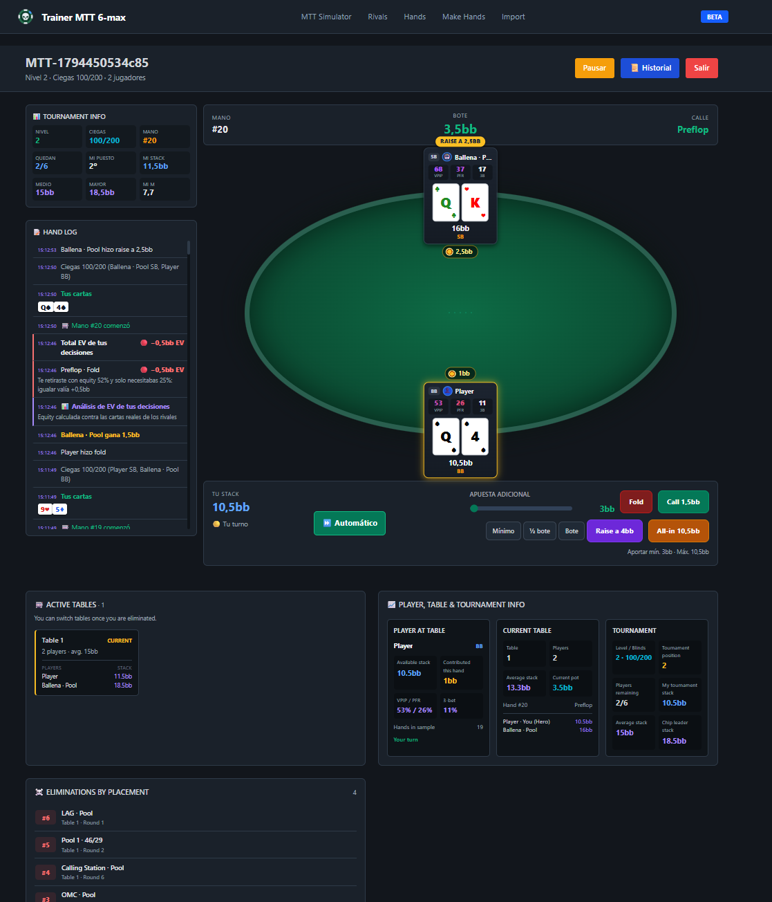

# Poker Trainer MTT

Poker Trainer MTT es una aplicación local para practicar póker de torneos multimesa (MTT), jugar contra rivales configurables y revisar manos y torneos. Esta es la segunda versión del proyecto y continúa en desarrollo.

La versión anterior se descartó porque no cumplía los estándares de diseño definidos para el proyecto. Esta versión se replanteó para ofrecer una base más adecuada para seguir desarrollando y mejorando la aplicación.

## Enfoque del proyecto

La aplicación permite crear y configurar bots con diferentes perfiles, jugar torneos MTT y analizar las decisiones tomadas durante las manos. También incluye un importador de manos de PokerTracker 4 para procesar historiales y generar perfiles de rivales a partir de las estadísticas observadas.

## Funciones disponibles

- Crear, editar, copiar y consultar bots desde la aplicación.
- Configurar perfiles, estadísticas y rangos de manos de los bots.
- Jugar y gestionar torneos MTT con varios rivales.
- Consultar y exportar historiales de manos y torneos, incluidos datos de análisis y EV.
- Explorar matrices de manos y escenarios de manos hechas.
- Importar historiales de PokerTracker 4 y generar perfiles de bots a partir de esos datos.
- Consultar bots mediante endpoints JSON.

El importador de PokerTracker está implementado. Procesa una copia de la base de datos en un entorno temporal y elimina esa copia al terminar. Los resultados se pueden revisar y ajustar desde la aplicación.

Las pruebas de juego de torneos realizadas hasta ahora han dado resultados aceptables para esta segunda versión. El proyecto seguirá mejorando a partir del uso, los comentarios y nuevas pruebas.

## Captura de la aplicación



## Estado actual y aspectos por pulir

### Cálculos de EV

La aplicación ya muestra datos de EV en los historiales, pero la configuración y los supuestos de esos cálculos siguen en desarrollo. Algunas partes pueden requerir revisión o ajuste manual según el tipo de torneo, la situación de juego y los criterios de análisis que se quieran utilizar. Los resultados deben considerarse una ayuda para estudiar manos, no una referencia definitiva.

### Cerebro de los bots

El sistema de decisiones de los bots es una primera versión funcional basada en reglas, perfiles, rangos y una percepción que varía según la habilidad. Está en proceso de pulido: se irán ajustando sus reglas, su comportamiento y las opciones de configuración.

### Reproducción de torneos

Se pueden consultar y exportar historiales, pero todavía falta poder cargar un torneo ya jugado y recrearlo paso a paso para repetir la partida y analizar sus decisiones.

### Otras mejoras previstas

Hay más ideas y mejoras planteadas que se irán definiendo durante el desarrollo. Entre ellas están ampliar las opciones de configuración, mejorar las herramientas de análisis y seguir refinando la experiencia de juego. Las prioridades pueden cambiar según los comentarios y las necesidades del proyecto.

## Generación de rivales desde PokerTracker

En `/import` se puede subir una copia comprimida de una base de PokerTracker 4. El sistema la procesa en una base temporal, calcula estadísticas de los jugadores y las distribuye entre perfiles de bot. Cuando un jugador no encaja en los perfiles disponibles, se puede generar un bot nuevo. Después de importar, los perfiles se pueden revisar y configurar en la aplicación.

Importa únicamente datos que tengas derecho a utilizar. La base temporal de trabajo se elimina al finalizar el procesamiento; los bots y resultados generados quedan en la base de datos de la instalación local.

## Tecnología

- **Aplicación web:** Laravel 13, PHP 8.3 o superior y Blade. Los recursos CSS y JavaScript se sirven como archivos estáticos.
- **Interfaz:** Blade con Tailwind CSS y Alpine.js. Los archivos servidos por Laravel están en `app/public/assets`.
- **Persistencia:** la configuración incluida en Docker usa PostgreSQL 15.
- **Servicios del entorno Docker:** Redis 7 y un servicio Python/Flask para simulación de equity y generación de tablas.

La lógica del juego y de los bots vive principalmente en `app/app/Services`; los modelos y controladores Laravel están en `app/app`, las páginas Blade en `app/resources/views` y las rutas en `app/routes`.

## Requisitos

- Docker Desktop y Docker Compose para iniciar los servicios con la configuración incluida.
- O, para ejecutar Laravel directamente, PHP 8.3+ y Composer. La base de datos debe configurarse en `app/.env`.

## Inicio con Docker

Desde la raíz del repositorio:

```bash
docker compose up -d --build
docker compose exec app php artisan migrate --seed
```

Docker incluye una clave de aplicación de desarrollo y publica los servicios solo en `127.0.0.1`. La clave es para uso local; define tu propia `APP_KEY` antes de exponer la aplicación fuera de tu equipo. Abre [http://localhost:8000](http://localhost:8000). Para consultar los servicios:

```bash
docker compose ps
docker compose logs -f app
```

Para detenerlos, ejecuta `docker compose down`. PostgreSQL y Redis usan volúmenes persistentes. `docker compose down -v` también elimina esos volúmenes y sus datos.

## Inicio de Laravel sin Docker

```bash
cd app
composer install
copy .env.example .env
php artisan key:generate
```

Configura la conexión a la base de datos en `app/.env` y luego ejecuta:

```bash
php artisan migrate --seed
```

En otra terminal, desde `app/`, inicia Laravel:

```bash
php artisan serve --host=127.0.0.1 --port=8000
```

Abre [http://localhost:8000](http://localhost:8000). La interfaz usa recursos estáticos incluidos en `app/public/assets`.

## Rutas útiles

- `/` — inicio.
- `/bots` — catálogo y configuración de bots.
- `/mtt-simulator` — torneos MTT.
- `/hand-matrix` — matriz de manos.
- `/made-hands` — escenarios de manos hechas.
- `/import` — importación de PokerTracker 4.
- `/api/bots` y `/api/bots/{id}` — datos de bots en JSON.

## Configuración y datos locales

Los ajustes de Docker están en `docker-compose.yml`. Laravel usa `app/.env`; parte de los valores de ejemplo se encuentra en `app/.env.example`. No publiques archivos `.env`, bases de datos locales, historiales importados, registros ni datos personales o de otros jugadores.

## Cómo colaborar

Puedes ayudar reportando errores, compartiendo ideas, revisando manos o proponiendo mejoras mediante issues y pull requests. Describe qué problema resuelve el cambio y cómo se puede revisar. Antes de aportar código, ten en cuenta que el proyecto se distribuye bajo PolyForm Noncommercial 1.0.0.

## Comunidad y apoyo

- **Discord:** Únete a nuestra comunidad en:
  [nuestro servidor de Discord](https://discord.gg/qSwwtekDF).

- **Donaciones:** si el proyecto te resulta útil, puedes apoyar su desarrollo con una donación.
  [](https://paypal.com)

## Colaboración con herramientas de IA

En el desarrollo de este proyecto han colaborado Claude, ChatGPT y GitHub Copilot como herramientas de apoyo. Las decisiones, la revisión y la responsabilidad sobre el código corresponden al equipo del proyecto.

## Licencia

El código propio de este repositorio se distribuye bajo **PolyForm Noncommercial 1.0.0**. Consulta las condiciones completas en [LICENSE.md](LICENSE.md) y en la [página oficial de la licencia](https://polyformproject.org/licenses/noncommercial/1.0.0). Los componentes externos mantienen sus propias licencias, que también deben respetarse.
